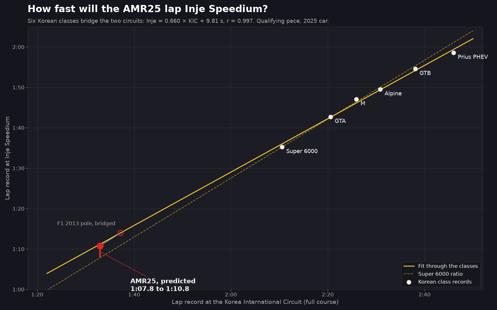

# How fast will the AMR25 lap Inje Speedium?

Aston Martin runs its 2025 car, the AMR25, at Inje Speedium on 28 November 2026, at the Run Universe Festival. The festival has a prediction game for the fastest lap and the top speed, so I worked out both from lap records and timing data before the day.

## Method

No F1 car has raced at Inje. F1 raced at the Korea International Circuit (KIC) in Yeongam from 2010 to 2013, and six Korean racing classes hold lap records at both circuits. Plotted against each other, those records fall on a straight line: Inje = 0.660 × KIC + 9.81 s, with a correlation of 0.997.

I put the 2013 Korean Grand Prix laps through that line: Sebastian Vettel's pole, 1:37.202, and his fastest race lap, 1:41.380. Then I scaled the result from a 2013 car to a 2025 car with the change in Suzuka pole times, from 1:30.915 to 1:26.983 (× 0.957). A second model uses the Super 6000 ratio instead (Inje ÷ KIC = 0.730). The two models give the ends of each range.

| Class | KIC full course | Inje |
| --- | --- | --- |
| Super 6000 | 2:10.540 | 1:35.239 |
| GTA | 2:20.564 | 1:42.713 |
| M | 2:25.873 | 1:47.062 |
| Alpine | 2:30.856 | 1:49.514 |
| GTB | 2:38.060 | 1:54.562 |
| Prius PHEV | 2:45.974 | 1:58.565 |

For top speed, I measured Inje's main straight in OpenStreetMap, because I found no published figure. It is 648 m long and follows a corner of 39 m radius. In the AMR25's 2025 data, corner speed rises with the square root of the radius, which puts that corner at about 110 km/h. The closest match is São Paulo 2025, where both cars left corners at 112 to 117 km/h. I read their speed 756 to 856 m from the apex, the distance from Inje's corner to Turn 1.

## Result

| | Lap or speed |
| --- | --- |
| Full pace, one flying lap | 1:07.8 to 1:10.8 |
| Full pace, race fuel and tyres | 1:10.8 to 1:13.4 |
| Realistic demo, my judgement | 1:17.3 to 1:24.3 |
| Top speed, no DRS | 301 to 305 km/h |

Two cross-checks land within 1.2 s of these ranges. GT3 cars raced at both circuits, so Inje's GT3 record (1:32.888) scaled by the F1 to GT3 ratio at KIC gives 1:10.7 at race pace. LMP2 cars never raced at KIC, so I used Shanghai 2013, where F1 and LMP2 cars qualified in the same year: Inje's LMP2 record (1:25.148) becomes 1:06.7, 1.2 s quicker than my qualifying range.

A demo run uses demo tyres and a driver ambassador, with safety margins, so I added 8 to 15 s to the middle of the full-pace range. Even 1:24.3 would beat Inje's lap record, the LMP2 car's 1:25.148 from 2014.

## Limits

- The fastest Korean class laps KIC in 2:10.540. The F1 lap is 33 s faster, so the line runs far past its data.
- Inje packs 20 turns into 3.9 km and is twistier than KIC. A car with this much downforce may gain more there than the line allows, which would make it faster than predicted.
- The era factor comes from one circuit, Suzuka, and one pole lap each year.
- The top speed comes from another circuit, with its own wing settings and weather, and assumes no DRS.
- The demo range is a guess, not a calculation. Change `DEMO_SLOWER` in `predict.py` to try your own.

To rerun it: `python research/inje-amr25/predict.py`

## Sources

- Korean class lap records: WVZine, [KIC](https://wvzine.com/?p=3845) and [Inje](https://wvzine.com/?p=3835)
- [2013 Korean Grand Prix](https://en.wikipedia.org/wiki/2013_Korean_Grand_Prix)
- Suzuka poles: [2013 Japanese Grand Prix](https://en.wikipedia.org/wiki/2013_Japanese_Grand_Prix), [2025 Japanese Grand Prix](https://en.wikipedia.org/wiki/2025_Japanese_Grand_Prix)
- Inje lap records: [Inje Speedium](https://en.wikipedia.org/wiki/Inje_Speedium)
- KIC GT3 record: [Korea International Circuit](https://en.wikipedia.org/wiki/Korea_International_Circuit)
- Shanghai 2013: [2013 Chinese Grand Prix](https://en.wikipedia.org/wiki/2013_Chinese_Grand_Prix), [2013 6 Hours of Shanghai](https://en.wikipedia.org/wiki/2013_6_Hours_of_Shanghai)
- Circuit geometry: OpenStreetMap ways [651693293](https://www.openstreetmap.org/way/651693293) and [677355827](https://www.openstreetmap.org/way/677355827), © OpenStreetMap contributors, ODbL
- AMR25 telemetry: the 2025 race data bundled with [Formula Analyst](https://github.com/OhKazakh/formula-analyst), from the official timing feed via [FastF1](https://github.com/theOehrly/Fast-F1)
