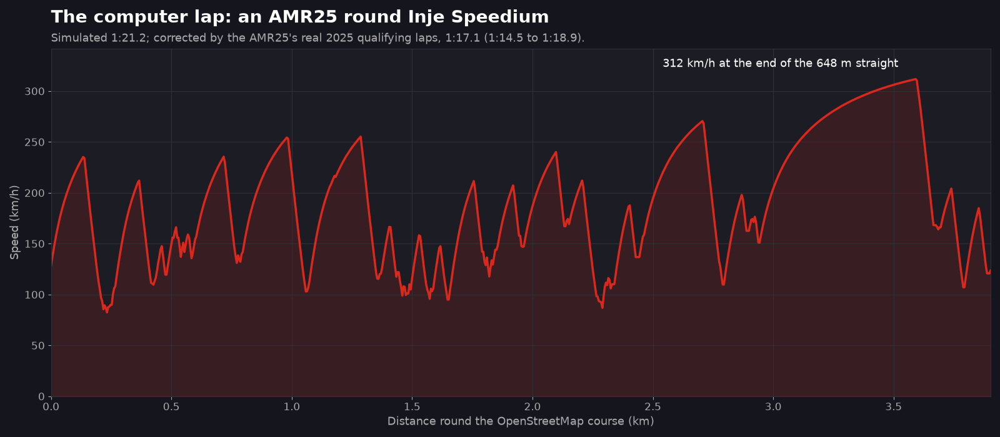

# How fast will the AMR25 lap Inje Speedium?

Aston Martin runs its 2025 car, the AMR25, at Inje Speedium on 28 November 2026, at the Run Universe Festival. The festival has a prediction game for the fastest lap and the top speed, so I worked out both from lap records and timing data before the day.

On the day the car ran a shorter layout than the one I modelled. The prediction below is as I published it; [What happened](#what-happened) compares it with the run.

## Method

No F1 car has raced at Inje. F1 raced at the Korea International Circuit (KIC) in Yeongam from 2010 to 2013, and six Korean racing classes hold lap records at both circuits. Plotted against each other, those records fall on a straight line: Inje = 0.660 × KIC + 9.81 s, with a correlation of 0.997.

I put the 2013 Korean Grand Prix laps through that line: Sebastian Vettel's pole, 1:37.202, and his fastest race lap, 1:41.380. Then I scaled the result from a 2013 car to a 2025 car with the change in Suzuka pole times, from 1:30.915 to 1:26.983 (× 0.957). A second model uses the Super 6000 ratio instead (Inje ÷ KIC = 0.730). The two models give the ends of each range.

| Class | KIC full course | Inje |
| --- | --- | --- |
| Super 6000 | 2:10.540 | 1:35.239 |
| GTA | 2:20.564 | 1:42.713 |
| M | 2:25.873 | 1:47.062 |
| Alpine | 2:30.856 | 1:49.514 |
| GTB | 2:38.060 | 1:54.562 |
| Prius PHEV | 2:45.974 | 1:58.565 |

For top speed, I measured Inje's main straight in OpenStreetMap, as I found no published figure: 648 m after a corner of 39 m radius, which the AMR25's 2025 corners put at about 110 km/h. At São Paulo 2025 both cars left corners at 112 to 117 km/h, and I read their speed 756 to 856 m later, the distance from Inje's corner to Turn 1.

## Result

| | Lap or speed |
| --- | --- |
| Qualifying lap, pole-level car | 1:07.8 to 1:10.8 |
| Qualifying lap, AMR25 (1.1% off pole in 2025) | 1:08.6 to 1:11.6 |
| Race lap, race fuel and tyres | 1:10.8 to 1:13.4 |
| Computer lap, qualifying trim | 1:17.1 (1:14.5 to 1:18.9) |
| Realistic demo, my judgement | 1:17.3 to 1:24.3 |
| Top speed, no DRS | 301 to 305 km/h |

Two cross-checks land within 1.2 s of these ranges. GT3 cars raced at both circuits, so Inje's GT3 record (1:32.888) scaled by the F1 to GT3 ratio at KIC gives 1:10.7 at race pace. LMP2 cars never raced at KIC, so I used Shanghai 2013, where F1 and LMP2 cars qualified in the same year: Inje's LMP2 record (1:25.148) becomes 1:06.7, 1.2 s quicker than my qualifying range.

The bridge works from pole laps, so it predicts the fastest 2025 car. The AMR25 qualified a median 1.1% off pole in 2025, which gives its own qualifying lap.

The computer lap simulates the AMR25 round Inje, with corner speeds, acceleration and braking from its 2025 telemetry, scaled by how the simulator compared with the car's real qualifying laps on the 24 circuits of 2025. It lands about 6 s slower than the bridge. It missed real laps by up to 13% on dry 2025 circuits and can't see Inje's banking and hills, so I trust the bridge more.

A demo run uses demo tyres and a driver ambassador, with safety margins, so I added 8 to 15 s to the middle of the pole-level qualifying range. Even 1:24.3 would beat Inje's lap record, the LMP2 car's 1:25.148 from 2014.

## Limits

- The fastest Korean class laps KIC in 2:10.540. The F1 lap is 33 s faster, so the line runs far past its data.
- Inje packs 20 turns into 3.9 km and is twistier than KIC. A car with this much downforce may gain more there than the line allows, which would make it faster than predicted.
- The era factor comes from one circuit, Suzuka, and one pole lap each year.
- The top speed comes from another circuit, with its own wing settings and weather, and assumes no DRS.
- The demo range is a guess, not a calculation. Change `DEMO_SLOWER` in `predict.py` to try your own.

To rerun it: `python research/inje-amr25/predict.py`

## What happened

On 28 November 2026 Jessica Hawkins drove the AMR25 on Inje's Course A, a 2.577 km layout, not the 3.908 km full course I modelled. Her timed run went 55.438, 54.493, 54.108 and 53.675 s, and her top-speed run reached 242, 272, 271 and 273 km/h. The weather was cold, and the report doesn't say which tyres or engine mode the car used.

My entry missed. I predicted a full-course lap without checking which layout the event would use, and I led with flat-out pace for a demo run.

To see what the method says about the lap she actually drove, `afterwards.py` builds Course A from OpenStreetMap: the full course plus the A Course link across it, which measures within 1.2% of the published length. The lap records only exist for the full course, so the computer lap carries them across. In the simulator Course A takes 0.642 of a full-course lap, a little under its 0.659 share of the distance, because it cuts a twisty section and keeps the main straight. It also joins that straight through a tighter corner, 33 m instead of 39 m, onto a longer run of 719 m.

| Course A | Predicted | Actual |
| --- | --- | --- |
| Qualifying lap, AMR25 | 44.1 to 46.0 s | |
| Race lap | 45.4 to 47.1 s | |
| Realistic demo, the same judgement | 49.6 to 54.1 s | 53.675 s |
| Top speed, no DRS | 306 to 308 km/h | 273 km/h |

- The demo judgement held on a layout it wasn't made for: 53.675 s is inside it, near the slow end, and 17 to 22% off the AMR25's qualifying pace.
- The lap-record bridge wasn't tested, because the car never ran flat out.
- Top speed missed by 33 to 35 km/h. Three runs within 2 km/h of each other point to a limit on the car, most likely a demo engine mode or a lift before Turn 1, not to the straight.
- Next time I'd confirm the layout first, and for a demo event lead with the demo number.

To rerun it: `python research/inje-amr25/afterwards.py`

## Sources

- Korean class lap records: WVZine, [KIC](https://wvzine.com/?p=3845) and [Inje](https://wvzine.com/?p=3835)
- [2013 Korean Grand Prix](https://en.wikipedia.org/wiki/2013_Korean_Grand_Prix)
- Suzuka poles: [2013 Japanese Grand Prix](https://en.wikipedia.org/wiki/2013_Japanese_Grand_Prix), [2025 Japanese Grand Prix](https://en.wikipedia.org/wiki/2025_Japanese_Grand_Prix)
- Inje lap records: [Inje Speedium](https://en.wikipedia.org/wiki/Inje_Speedium)
- KIC GT3 record: [Korea International Circuit](https://en.wikipedia.org/wiki/Korea_International_Circuit)
- Shanghai 2013: [2013 Chinese Grand Prix](https://en.wikipedia.org/wiki/2013_Chinese_Grand_Prix), [2013 6 Hours of Shanghai](https://en.wikipedia.org/wiki/2013_6_Hours_of_Shanghai)
- Circuit geometry: OpenStreetMap ways [651693293](https://www.openstreetmap.org/way/651693293), [677355827](https://www.openstreetmap.org/way/677355827) and, for Course A, [677355824](https://www.openstreetmap.org/way/677355824), © OpenStreetMap contributors, ODbL
- The run on 28 November: [autoracing.co.kr](https://www.autoracing.co.kr/news/articleView.html?idxno=50652)
- AMR25 telemetry: the 2025 race data bundled with [Formula Analyst](https://github.com/OhKazakh/formula-analyst), from the official timing feed via [FastF1](https://github.com/theOehrly/Fast-F1)
